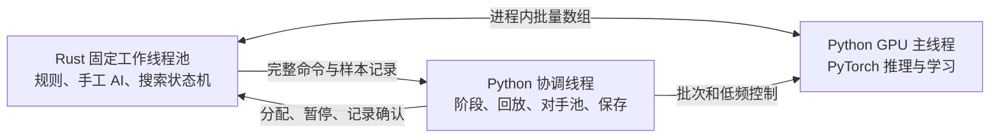

# 单进程 Rust 线程池与 PyTorch 运行时

当前线程、所有权和保存契约。策略与搜索定义见[训练设计](TRAINING.md)，命令见[运行说明](../../training/README.md)。

## 线程与数据所有权

默认 8 个 Rust 线程、每线程 8 局。每局固定归属一个线程，局面中的 `Rc` 不跨线程；跨线程消息只包含独立控制值和拥有明确生命周期的连续数组。每个 lane 最多等待一个神经响应或正式记录确认，等待时线程推进其他就绪局。

GPU 主线程独占 CUDA、学习模型、优化器、推理模型和编码缓存。协调线程拥有训练阶段、NumPy 协调 RNG、GameBuffer、Replay、历史池与磁盘写入，顺序完成派局及抽样。新局轮转分配到工作线程，游戏编号、种子和对手由协调 RNG 生成，每局随机流不依赖线程位置。

Web 服务另有一个轻量控制进程，管理唯一训练子进程。HTTP 请求不进入逐步搜索或推理路径，见[控制台说明](TRAINING-WEB.md)。

## 搜索与随机数

原生状态机依次完成唯一命令检查、根编码、选择/扩宽、条件前缀解码、规则分支、新叶编码、回传及正式落子。遇到神经请求即保存状态并让出工作线程；热路径使用类型化 Host 方法，不逐节点往返 JSON 或 Python 回调。

候选、边和监督保持插入顺序，PUCT 与 argmax 平手取第一项。普通扩宽的单选前缀免神经评估，但保持 choice 的随机消耗；温度大于零时最终单选策略仍抽样。softmax 使用 f32 exp/sum 后转 f64，先验、累计价值和剩余质量使用 f64。

每局持有 PCG64 的 128 位 state/inc 和 has_uint32/uinteger，初始化由 NumPy 完成。gamma、bounded uint64 与 f32 exp 直接调用 NumPy 无 GIL C 内核，保持随机消耗和搜索舍入。函数、context、auxdata 及所属 DLL/capsule 在原生池存活期间保活。私有 ABI 固定 NumPy **2.5.3**，升级须重新完成接口和搜索差分。

128 位整数仅在 FFI 控制 JSON 中使用十进制字符串，保存 v3 检查点时转换回 Python 整数。每次命令开始前克隆根 RNG，teacher/demo 同样先消耗深搜抽样。测试从 Git 冻结的 Python 搜索读取参考算法；生产只使用原生搜索。

## 批量 FFI 与数组生命周期

控制接口负责 assign、pause、resume、snapshot、status 和 active_versions。请求批次提供 lane、game、step、context、操作、版本及连续数组视图；输出以 BF16 原始 uint16 位和 offsets 整批回填。记录批次提供正式命令、info 和可选监督，确认记录后 lane 才继续。close 先停止并 join 工作线程，再释放池与库引用。

Python 在请求批次释放前只读借用 Rust 数组，推理返回 CPU 输出后释放请求批次。记录转入 GameBuffer 时复制为 Python 拥有的数组，随后由回放及恢复点持有。队列容量由 lane 数限制，记录消费较慢时对对应 lane 施加背压。

就绪队列达到 32 个请求或最老请求等待 2 ms 时出队；Python 按版本和 encode/decode 分组，组内按长度排序。空队列阻塞于 Condvar，学习或控制任务主动唤醒。推理批次边界最多执行一个已准备的学习批次。

## 模型、阶段与存储

模型为 5,503,366 参数，参数、梯度、AdamW 动量和神经浮点张量均为 BF16，步数与索引为整数。普通发布只复制 CPU BF16 权重，GPU 最多缓存三个推理版本，当前及在途根引用保活。只有历史池成员写独立文件，CPU 历史缓存预算为 256 MiB。

根首次响应固定该次搜索版本，历史对手整局固定版本。编码缓存按 lane、根命令、节点及版本区分，正式命令提交后释放。GPU 完成发布后才通知协调线程；collect → imitation → self 等待相应采集、学习和发布完成。

每 64 条命令将监督片段交入内存回放，默认限制 128 局和 4 GiB 张量。超限按最早入池整局淘汰，单片段超预算报错；在途环境、尚未打包样本及少量命令/时间线元数据不计入张量预算。终局标签与缓冲共享元数据，训练抽样不读取轨迹文件。

磁盘保留历史权重、一个滚动 `checkpoint.pt`、覆盖更新的 `status.json` 和必要故障诊断。每 300 秒或正常停止时原子替换 v3 检查点，包含模型/优化器、必要临时版本、有限回放、在途缓冲、随机数和阶段。只接受当前格式。

## 暂停、恢复与异常

停止新分配和新学习，暂停原生推进，收回已发出的神经响应，通过屏障确认版本与响应齐全。协调线程排空正式记录、打包样本，取得原生根环境、命令开始前 PCG64、root_version 和手工 AI 计划；GPU 提供模型、优化器、版本与 Torch/CUDA RNG，最后原子写入检查点。

恢复从保存的命令起点重算未完成搜索，保留每局回合上限。按新的线程/在途容量重分配原局，超出容量的快照放入 `workers[-1]` 队列，空位优先恢复。根版本按游戏编号保活，待恢复局也随检查点保存。修改学习率同步更新优化器参数组。

周期保存后恢复原池；正常退出先 join 原生线程，再释放数组与 NumPy 库。异常暂停相关工作，只有环境、GPU 和正式记录状态齐全才替换恢复点，否则保留上一次完整恢复点及失败诊断。未完成局保持 unknown。

## 分段诊断口径

功能检查覆盖请求、命令、监督及 RNG 差分，线程隔离、数组生命周期、BF16、历史版本、预训练、截断和保存恢复。统一性能基准固定起点、反馈、64 在途局及搜索/学习工作量，整体实现后才比较吞吐和资源占用。

`HAOJIE_PROFILE=1` 开启诊断，默认关闭。Rust 线程本地计数器记录阶段调用数、包含/排除子段的 wall 纳秒，Windows 另记录 QueryThreadCycleTime CPU 周期。Python 分别记录 GPU 主线程及协调线程的 wall/thread CPU 时间，嵌套阶段扣除子段。线程 wall 含调度等待，累计时间不作为整局墙钟百分比。

CUDA Events 对 encode/decode 每 32 批、训练每 8 批抽样，只 query 已完成事件，不增加逐段 synchronize。流区间可能含主机提交间隙，按 stream_elapsed_seconds 单列。原生诊断另含出队原因、锁/条件变量等待、队列年龄和批量；GPU 记录分组与实际/padding 元素数。

`HAOJIE_TRACE=<路径>` 在 GPU 循环第 64–95 次采集 32 个完整循环，`HAOJIE_TRACE_START_SECONDS` 可改用延迟开始。trace 和开始/结束计数独立落盘，用于区分 kernel、copy、同步及提交 API，含 profiler 开销的运行不进入吞吐对照。外部 CPU/GPU 采样与命令见[运行说明](../../training/README.md#验证和性能)。
