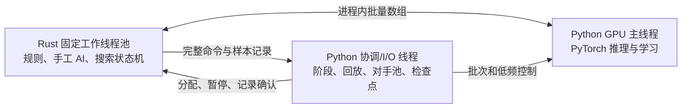

# 单进程 Rust 线程池与 PyTorch 运行时

2026-10-29，实施前冻结。基线为 `7cc4ba9`；其 Python 源码和当时 DLL 已保存到 `artifacts/classic-native-pool-20261029/baseline/`。先完成本设计，再整体实施和正确性验收，最后一次性比较吞吐与 CPU/GPU 利用率；测量过程中不调参。

## 目标与保持范围

移除 Python 多进程、Pipe、共享内存打包和逐节点 Python 搜索。CPU 原生线程池连续供给 GPU，Python/PyTorch 继续负责神经计算，不引入 C++ 或 LibTorch。

保留 5,503,366 参数模型及全部特征、损失、样本权重、AdamW 数学和原生 BF16；参数、梯度、动量、神经输入/输出都是 BF16，步数及索引保持整数。CPU 规则事实与搜索统计仍使用原数据类型。

保留 64/16 次模拟、25% 深搜、完整命令深度 16、PUCT 系数、渐进扩宽、根噪声、温度和转置/循环回传。单局模拟仍依次完成，并发来自独立对局。普通局规则、三档手工 AI、预训练、70/20/10 对手混合、跨时期历史池、价值/辅助目标、50 ply 截断和 25% 完整局均不变。

本次架构重构比较时保留 4 个 CPU 执行单元、每单元 16 局，总计 64 局。`--workers` 在新运行时表示 Rust 线程数，保留原参数及检查点映射。后续独立线程数试验确认 8×8 吞吐更高，当前新运行默认改为 8×8，总在途及学习 batch 16 不变；完整记录见[状态入口](STATUS.md)。

## 线程与数据所有权

只有一个操作系统进程。GPU 主线程独占 CUDA、学习模型、优化器、发布模型和编码缓存；协调线程拥有 Trainer 的策略状态、NumPy 协调 RNG、GameWriter、Replay 和磁盘写入。协调线程顺序完成对局分配与回放抽样，避免并发消耗原来共用的 RNG。

每局固定映射到一个 Rust 线程。Host、State、Command、Catalog 中的 Rc 留在所属线程内，禁止通过 unsafe Send 跨线程移动。跨线程消息只包含整数、独立控制 Value、Vec/Arc 连续数组及 BF16 输出。工作线程在一局等待神经响应或记录确认时继续推进其他就绪局。

线程数和在途局数分离。每 lane 最多一个神经请求或一个待确认的正式命令记录；队列容量由 lane 数自然限制。Python I/O 较慢时对相应 lane 施加背压，不无限堆积样本。

新对局按工作线程轮转分配空闲 lane，使少量示范局也覆盖所有线程；既有检查点仍恢复原来的 lane。对局编号、种子及对手选择继续由同一个协调 RNG 顺序生成，单局不因线程位置更换随机流。

## 原生搜索与随机数

搜索从 Python 生成器整体迁入 Rust 状态机：检查唯一合法命令 → 根编码 → 选择/扩宽 → 条件前缀解码 → 规则分支 → 新叶编码 → 回传 → 根策略和正式命令。遇到神经请求时保存状态并让出工作线程，不等待 GPU，也不在每一步回调 Python。

复用现有规则、编码和合法动作解码；Host 增加类型化方法，原 hc_call 保留为开发/恢复兼容入口。热路径不构造 JSON 请求字符串、不往返解析 Python 字典。图节点键仍由现有公开状态规则生成；GPU 编码缓存使用局部节点整数 ID，公开状态键可供差分检查。

候选/边/监督维持插入顺序，PUCT 与 argmax 平手取第一项。唯一完整命令入口免搜索抽样；普通扩宽中的单选前缀仅免神经评估，仍保持旧 choice 的随机消耗；温度大于零时最终单选策略也照常抽样。softmax 保持 f32 exp/sum 后转 f64，先验、累计价值和分支剩余质量保持 f64；不把原计算整体改成 f64。差分逐条核对命令、随机状态、访问数和训练监督，浮点数组按原精度检查。

Rust 持有可复制的 PCG64 状态：128 位 state/inc 和 has_uint32/uinteger。种子初始化继续由 NumPy 完成，赋给新局后移交原生线程；恢复原 v2 的完整状态。原生 gamma 和 bounded uint64 直接调用已安装 NumPy 导出的 C 分布函数，函数地址在建池时一次传入，不进入 Python/GIL。PCG64 next64/next32/next_double 与 NumPy 逐位对照，Dirichlet、加权 choice 和模拟种子也保持原算法及随机消耗顺序。

跨端正确性验收发现标准 Rust exp 与 NumPy f32 exp 的 1 ULP 差会改变接近平手时的 PUCT 顺序，因此原生搜索也复用 NumPy 的无 GIL f32 exp 内核；函数/context/auxdata 在建池时传入并保活 capsule。不会以放宽命令或请求差分来接受这一变化。此 capsule 是版本相关 ABI，依赖与启动检查固定 NumPy 2.5.3；升级时须重新完成原生接口和搜索差分。

128 位整数仅在 FFI 控制 JSON 中使用十进制字符串，Python 写回 v2 检查点时转换回整数，避免 serde_json 大整数精度损失。每次命令开始前克隆根 RNG，teacher/demo 同样先消耗 deep 抽样。

## 批量 FFI 与数组生命周期

原生池暴露以下接口，名字可按现有 hc 前缀统一：

| 接口                        | 契约                                                                                            |
| --------------------------- | ----------------------------------------------------------------------------------------------- |
| new/configure               | 线程数、采集配置、NumPy C 函数地址；不创建子进程                                                |
| control                     | 低频 assign、pause、resume、snapshot、status、active_versions；控制 JSON 由独立锁保护           |
| take_requests(max, wait_ms) | 从统一就绪队列获取一个拥有数组的请求批次；每请求使用 C 结构描述                                 |
| request_view                | lane、game、step、context ID、encode/decode、版本引用、各连续数组指针/长度；不序列化逐节点 JSON |
| reply                       | 连续 BF16 uint16 输出、offsets 和模型版本整批回填；随后才恢复对应 lane                          |
| take_records / record_view  | 已提交命令/info 与可选监督；低频 JSON 元数据加连续数组                                          |
| acknowledge_records         | Python 已取得拥有权的样本和命令后，允许 lane 开始下一个命令                                     |
| release_batch               | 显式释放批次拥有的数组；释放前视图稳定                                                          |
| wake                        | 本地学习/控制任务唤醒 GPU 等待的原生 Condvar                                                    |
| close                       | 先停止并 join 工作线程，再释放池和 DLL 引用                                                     |

GPU 请求输入通过 NumPy 只读视图直接借用 Rust 内存，复用现有 BF16 collate/Compute 数学。GPU 批次已消费输入后才 release；当前 infer 返回 CPU 输出时已完成必要同步。记录进入 GameWriter 时复制为 Python 拥有的数组，避免后续落盘使用已释放内存。

请求按模型版本和 encode/decode 分组，保留 batch 32 与 2 ms 最老请求等待界限。没有工作时阻塞在原生 Condvar；协调线程有学习/发布/保存命令时唤醒，不以 Python 忙轮询代替进程通信。GPU 在推理批次边界最多执行一个已准备的学习批次，维持既有调度规则。

## 模型、阶段与记录

根的首次神经请求由 GPU 解析当前版本，结果回填后固定；后续前缀与叶评估沿用该版本。历史方整局指定历史版本。GPU 缓存按 lane、根命令、节点、版本区分，命令提交或换根时释放旧上下文。

GPU 主线程完成发布后才通知协调线程。回收文件保护历史池、所有在途历史对局、根版本及检查点引用。协调线程仍执行 collect→imitation→self：示范全部自然结束后才独立模仿，最后一次模仿更新发布完成后才分配自对弈。

正式命令记录包含原 info、命令和必要的分层监督；继续使用 autoregressive-v2 文件格式。demo 总写示范监督；self 只写深搜监督；history/teacher 只学习 learner 方。终局优先于截断，unknown 不补胜负，软目标门槛与权重不变。回放抽样与学习额度保持原逻辑。

## 暂停、恢复与异常

停止新分配和新学习，暂停 Rust 线程推进；已发出的 GPU 请求完成回填，并通过原生屏障确认版本与响应已收回。协调线程排空此前的正式记录并 flush，再取得原生权威根环境、命令开始前 PCG64、root_version 和手工 AI 计划。GPU 主线程取得模型、优化器及 Torch/CUDA RNG，协调线程原子写回原 v2 检查点。

搜索中的模拟局面不作为正式命令记录。恢复丢弃中间搜索树与 GPU 缓存，从保存的原命令起点重算；旧 worker/lane 映射、旧在途局的 ply_limit 分配保持。周期保存后恢复同一池；退出 join 原生线程后再释放数组及 NumPy 函数所属 DLL。

原生线程错误上报并暂停相关工作；只有环境、GPU 与记录状态齐全才替换主检查点，否则保留上一完整恢复点和失败信息。异常路径不能把未完成局写成终局。

## 实施分工和删除范围

Rust 实现随机数、搜索状态机、类型化 Host、固定归属线程池、批次 FFI 和原生单元测试。Python 实现池的 ctypes 桥、单进程 GPU/协调循环、同格式记录与恢复。Compute 的训练数学、Trainer 策略状态、Replay、Calibration 和历史池继续复用。

训练和评测共用原生搜索。删除正式运行依赖的 Python 搜索生成器、多进程 worker、Pipe/SharedMemory 和旧 IPC 基准；冻结 Python 搜索只从 Git 基线导出用作差分参考，不保留生产 fallback。

## 验收顺序

1. 全部设计冻结后整体实施。中途只运行正确性检查，不采集或比较性能。
2. 核对 NumPy PCG64、gamma、Dirichlet、choice、模拟种子和状态恢复；核对新旧搜索逐条请求输入、命令、根访问/先验、监督和最终 RNG。覆盖唯一命令、同方行动、终局、转置、循环、深度和超过 32 动作。
3. 验证线程隔离、数组生命周期、无子进程、BF16 参数/梯度/优化器、模型版本、预训练阶段、历史对手、截断与真实标签、旧 v2 恢复、周期保存和停止。
4. 全部完成后冻结代码，再统一测量。基线为独立源码及原 DLL；固定模型、64 在途局、64/16 搜索、学习数据和更新数量，新旧交错三轮。采用固定作业队列，例如 256 个窗口×8 命令，结束后补下一作业，逐组工作量完全一致。
5. 吞吐使用全部固定工作量的总耗时。CPU/GPU 利用率由外部采样进程记录，只统计预热后仍维持 64 局且有待分配作业的区间，排除尾部排空；记录 Rust 系统线程 ID、GPU 主线程 CPU 时间、GPU 活动率/功耗/时钟、实际批次、队列等待、搜索及训练消费量。
6. 正负结果一并写回状态入口；不根据单项结果再追加局部调参。

## 分段诊断口径

`46d3268` 是本次诊断的插桩前提交。保持 8×8、学习 batch 16、推理上限 32、64/16 搜索及原生 BF16；只增加可关闭的诊断，不优化算法或调度。`HAOJIE_PROFILE=1` 开启，默认关闭。

Rust 工作线程使用线程本地嵌套计数器，输出每段调用数、包含子段与扣除子段的 wall 纳秒。顶层区分工作、控制、阻塞等待和暂停；内部区分纯搜索、规则执行、状态分支、公开观察、指标、状态键、合法解码、实体/几何/动作编码、手工 AI 和正式记录。Windows 同时读取 `QueryThreadCycleTime`，以独占 CPU 周期比较阶段的执行成本，不将周期换算为秒。各线程计时在本线程内闭合；wall 包含调度抢占，不把八个线程累计耗时当作整局墙钟百分比。

Python 分别记录 GPU 主线程与协调线程的 wall 和 thread CPU 时间，并扣除嵌套子段。主路径区分原生队列等待、FFI 视图构造、请求分组、CPU 组批、H2D 提交、网络提交、D2H/同步等待、结果与缓存、回复；学习拆为数据准备、前向/损失、有限性检查、反向、梯度裁剪、优化器和标量报告。协调线程单列派局、回放抽样、记录处理、控制等待与保存。

CUDA Events 按 encode/decode 各每 32 个批次、训练每 8 次抽样，并保存总/样本次数与样本数。只在原有同步之后 query 已完成事件，不增加逐段 synchronize。事件给出的流时间范围可能包含主机提交间隙，按 `stream_elapsed_seconds` 单列，不当作 kernel 活跃时间，也不与 CPU 时间相加。[CUDA Event 口径](https://docs.nvidia.com/cuda/cuda-runtime-api/group__CUDART__EVENT.html)、[Windows CPU 周期口径](https://learn.microsoft.com/en-us/windows/win32/api/realtimeapiset/nf-realtimeapiset-querythreadcycletime)。

使用同一冻结反馈和 256×8 工作量，按 OFF/ON、ON/OFF 对照插桩开销，逐轮核对命令、监督、RNG 和搜索/学习数量，并记录实际组批变化。独立 `HAOJIE_TRACE=<路径>` 运行在 GPU 循环第 64–95 次采集一个短 CPU/CUDA trace，记录阶段标签、真实 kernel/copy 与启动/同步调用；trace 和开始/结束计数单独落盘。该运行包含 profiler 自身的开销，不进入吞吐对照。诊断结束后据实际分项归因，不在同轮追加优化。
