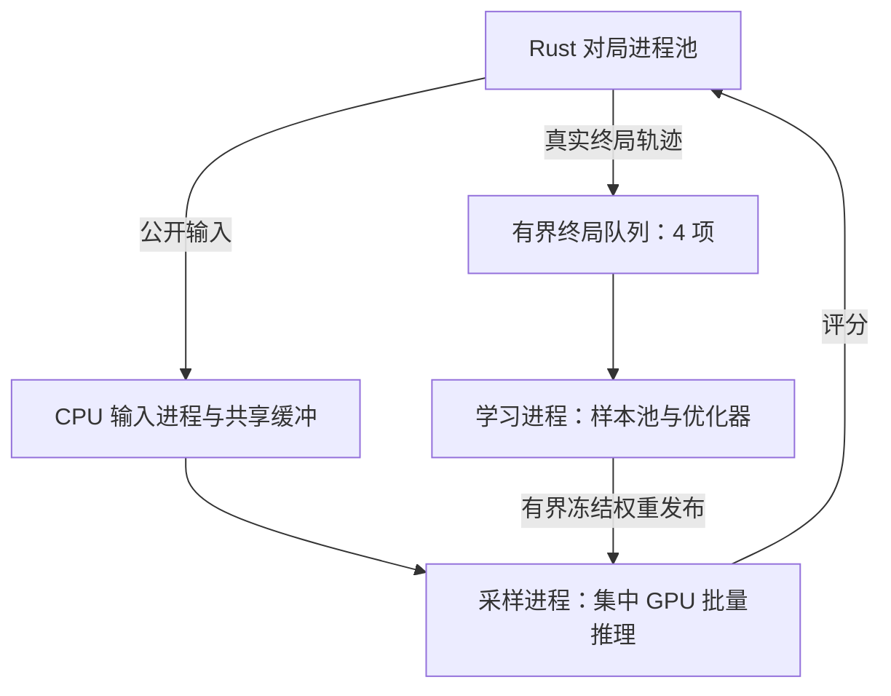

# 训练流水线与性能验收

本文维护当前执行架构、诊断方法和交接结论。逐轮实验日记、已删除脚本的命令及旧性能表已清理，历史原文由[历史索引](../docs/ai/HISTORY.md)指向固定提交。本地模型、优化器、真实轨迹、冻结源码与关键失败报告继续保留。

## 当前架构

正式模型仍为 `entity-transformer-v3`，11,695,874 个参数；公开编码、候选域、MC-Q v2、终局收益、补偿 BF16 AdamW 和每局 20,000 命令 / 1,000 ply 预算保持原定义。CUDA 默认采用独立采样进程，CPU 参考执行和固定权重评测复用本地 Pool。



- 采样进程拥有冻结推理模型、历史快照和环境池；学习进程拥有可变模型、优化器、RAM 样本池、保存与评测。学习和保存期间采样继续。
- 终局队列四项。队列满时，结案槽保留自身轨迹，交接后独立补局；其他在途局继续推理。每槽最多一条在途或待交接轨迹，暂存条数受最多 128 槽约束。每局仍最多保留 128 条样本，单样本上限 512 KiB。
- 逐请求传共享缓冲描述符与 BF16 评分；只有真实结案将轨迹交给学习器，沿用同一 `MemoryJobs.finish` 物化样本及收益。截断和取消保持 unknown。暂停排空已完成轨迹，再取消在途局；恢复点仍只保存学习状态，RAM 样本与在途局不落盘。
- 权重邮箱最多一项，另合并保留最新待发版本。当前策略最多四份根快照，同根绑定原版本，新根领取最新发布版本；历史对手整局冻结。无引用版本回收，下一局已选历史计划也持有租约。
- 一次 CPU 权重快照同时供摘要、发布与历史保存使用。采样池清理使用弱引用，避免回调额外保留旧模型。
- Notebook 默认 `HOST_WORKERS=-1`，按 CPU/RAM 自动选择输入进程；显式数量仍可覆盖。多进程不改变训练 batch 或自动更新公式。

`runtime.sampling_seconds` 是采样进程时钟，与学习器阶段时间重叠；跨进程 CPU 累计不可直接相加当墙钟。GPU 分配/预留显存汇总两个 CUDA 所有者。队列诊断包括 `pending_terminals`、`pending_terminal_bytes`、`terminal_transfer_seconds` 和 `terminal_backpressure_seconds`。

## 完整周期证据

以下使用 RTX 3060 Laptop。固定晚盘用于快速对照，持续窗口用于观察采样与学习竞争；各表保留实际样本及更新数。启动、预热与样本哈希单列，完整周期包括采样、更新、结案排空和恢复点保存。

Linux 单环境四个固定任务、本地与流水线均完成 512 条样本、两次更新，样本摘要相同：`18bf7765667d5523e98f82d5e4bca9c05757454e5f4599dbee1b7430108d2488`。

64 环境、128 个固定晚盘任务、推理上限 64、一个输入进程、无历史对手、16 次更新：

| 宿主 / 执行    | 完整秒数 | 真实终局样本/秒 | 更新数 | 主进程 CPU 秒 |
| -------------- | -------: | --------------: | -----: | ------------: |
| Linux 本地     |   30.881 |         486.771 |     16 |        25.445 |
| Linux 流水线   |   28.282 |         531.505 |     16 |         3.785 |
| Windows 本地   |   35.952 |         417.167 |     16 |        33.703 |
| Windows 流水线 |   34.521 |         435.443 |     16 |         5.016 |

这组完整周期分别提高 9.19% / 4.38%。多环境轨迹摘要不同；Linux 两侧均保留 15,032 条样本，Windows 为 14,998 / 15,032 条。报告为 `pipeline-{local,pipeline}-finite-1` 与 `pipeline-win-{local,pipeline}-finite-1`。

Windows 持续晚盘：128 环境、推理上限 64、一个输入进程、50% 历史对手、生产自动更新、120 秒采样窗口，再收尾保存。

| 执行                             | 完整秒数 | 终局样本/秒 | 消费样本 | 更新数 |
| -------------------------------- | -------: | ----------: | -------: | -----: |
| 本地参考                         |  120.884 |      93.486 |        — |  2,861 |
| 流水线，阻塞发送，第 1 轮        |  122.424 |      95.602 |        — |  2,941 |
| 流水线，阻塞发送，第 2 轮        |  122.666 |      95.716 |        — |  2,824 |
| 流水线，逐槽背压                 |  124.622 |     181.269 |   18,276 |  2,326 |
| 逐槽背压 + 分组健康检查，第 1 轮 |  125.488 |     166.039 |        — |  1,655 |
| 逐槽背压 + 分组健康检查，第 2 轮 |  125.374 |     165.952 |        — |  1,679 |

阻塞发送曾累计堵住集中推理 79–89 秒。逐槽背压提高了采样供给，但学习侧出现积压，更新量下降。分组检查的局部收益也尚未转化为完整周期收益，当前流水线的持续学习吞吐仍需复核。报告分别为 `pipeline-win-local-continuous-120-1`、`pipeline-win-pipeline-continuous-120-{1,2}`、`pipeline-win-credit-continuous-120-1`、`pipeline-health-continuous-120-{1,2}`。

## 并发扩展与最后一项组批对照

`frozen-pipeline-12`、Windows、同一 BF16 初始化、128 个晚盘任务、一个输入进程、无历史对手、推理上限 64、等待 0 ms、16 次更新。各点均完成全部真实终局、消费 128 条训练样本并保存；保留样本为 14,998–15,032 条。

| 环境数 | 完整秒数 | 终局样本/秒 | 实际平均推理批量 | GPU 平均利用率 |
| ------ | -------: | ----------: | ---------------: | -------------: |
| 1      |  215.629 |      69.555 |             1.00 |          40.9% |
| 2      |  173.532 |      86.428 |             1.00 |          34.4% |
| 4      |  102.497 |     146.326 |             1.26 |          42.9% |
| 8      |   60.576 |     248.149 |             2.39 |          51.8% |
| 16     |   48.301 |     311.216 |             4.45 |          58.6% |
| 32     |   39.607 |     379.526 |             7.22 |          60.6% |
| 64     |   35.584 |     422.432 |            10.04 |          64.6% |
| 128    |   33.615 |     447.186 |            13.11 |          71.1% |

四环境为单环境的 2.10 倍，128 环境为 6.43 倍，距离斜率为 1 的目标很远。128 环境的进程树平均约使用 2.94 核；批量碎片和固定任务尾部仍明显。该曲线包含固定的更新与保存成本。报告为 `pipeline-v3-scaling-{1,2,4,8,16,32,64,128}-1/report.json`。

最后只改变 64 环境的组批等待，仍用同一冻结源码、初始化和任务：

| 等待 | 完整秒数 | 终局样本/秒 | 平均推理批量 | GPU 平均利用率 |
| ---- | -------: | ----------: | -----------: | -------------: |
| 0 ms |   35.584 |     422.432 |        10.04 |          64.6% |
| 1 ms |   52.548 |     286.063 |        12.57 |          50.0% |

两侧均完成 128 个真实终局、15,032 条样本、16 次更新和保存，零截断。增加等待使批量略大，完整吞吐反而下降 32.28%；因此保留 **0 ms** 默认值，停止继续调参。候选报告为 `pipeline-v3-batch-wait1-64-1/report.json`。

## 剩余热点与已撤回方向

学习侧 CPU 剖析中，`Trainer._loss` 占约 15.23 秒线程 CPU / 15.67 秒墙钟；采样侧网络前向占约 11.27 秒线程 CPU。学习阶段 32 次更新的 CUDA 时间线包含 25,595 次内核发射、2,209 次 `isfinite`、64 次 `nonzero` 和 649 次 `item`。两侧都存在大量小算子调度；增加 Rust 环境数无法直接消除这些成本。

| 方向                       | 实测与处置                                                                                                                                                   |
| -------------------------- | ------------------------------------------------------------------------------------------------------------------------------------------------------------ |
| 单 CUDA 所有者与共享帧 RPC | 120 秒窗口为 175.289 条/秒、2,257 次更新，低于逐槽双进程版本；已删除服务线程、RPC 和专用测试。                                                               |
| TorchScript 前向图         | 169.564 条/秒、2,272 次更新；已删除追踪、专用测试与为追踪改写的模型表达式。                                                                                  |
| 分组有限值检查             | 93 个参数、465 个 Adam 状态的实际模型检查从约 38–43 ms 降至 3.2–3.3 ms；NaN/Inf、空张量、BF16 极值与非连续张量已覆盖。持续周期结果见上表，保留该风险供复审。 |
| v4 根编码复用 / CUDA Graph | 未晋升；短学习收益没有改善，图执行长跑发生非法访存。正式路径保留 v3，候选只留本地冻结证据。                                                                  |

原始证据统一位于 `artifacts/bf16-elastic-20261023/`；流水线源码冻结为 `frozen-pipeline-*`，关键 CUDA 时间线为 `pipeline-learning-cuda-30-1/trace.json`。Windows 32 GiB 宿主可完成 128 环境；本机 WSL 8 GiB 上限曾在约 7.38 GiB 进程树 RAM 时中断。失败时保存健康恢复点，故障报告和源码保留。Colab L4 与 TPU 实机结果尚未取得。

复审优先核对：采样与学习是否因 GPU 竞争降低更新产出；有限值检查的微基准与整周期差异；小批量供给和长局尾部；权重发布与样本消费顺序带来的工作量差异。模型与算法取舍留待复审，当前停止追加优化。

## 维护诊断入口

从仓库根运行，先设置 `PYTHONPATH=training`；每次输出目录必须新建。C++ 缓存和引擎先构建，计时期间独占 GPU，不并行编译或测试。

```sh
python -m haojie_training.diagnostics \
  --engine /path/to/haojie-engine --output artifacts/diagnostic-new \
  --sampling-backend pipeline --environments 64 --host-workers 1 \
  --inference-batch-size 64 --batch-wait-ms 0 --history-percent 0 \
  --games 128 --finite --updates 16 --deadline 1200 \
  --starts tests/fixtures/native/late-starts.json.gz --start-indices 0 2
```

`--sampling-backend local` 对照本地执行；`--initialize-from` 只读加载同一初始权重。固定工作量须核对引擎、源码、起点与初始权重哈希，以及真实终局、样本集合和消费顺序。并发执行改变轨迹时分别报告工作量。

持续窗口使用 `--seconds 120 --updates 0 --history-percent 50` 并去掉 `--finite`；省略 `--starts` 即自然新局。`--resize-at 10:8 --resize-at 30:2` 验证运行中伸缩。主指标同时读取 `terminal_samples_per_second`、`consumed_samples_per_second`、`updates_per_second` 和 `training_work`，收尾的 unknown 单列。

`--profile cpu` 分账采样与学习；`--profile cuda --profile-stage learning` 捕获学习侧时间线，默认 stage 为 sampling。剖析输出与普通计时分开；不要把剖析运行列入吞吐对照。子进程分账存于输出目录 `sampling/`，主报告同时嵌入。

## 本次收口检查

当前源码的 Windows CUDA 闭环完成四个真实终局、512 条样本、两次更新与保存，零截断，关闭后 `pending_terminals=0`；报告为 `pipeline-final-smoke-1/report.json`。Windows 定向 16 项中 14 项通过、一项因 Linux 信号语义跳过、一项等待终局队列填满的 30 秒检查超时；同一背压 / 2→4→1 伸缩 / 重复关闭检查在 Linux 通过，耗时 52.403 秒。诊断记账五项在 Linux 通过，保留 Windows 超时日志供复审。

Ruff、修改文件格式、目录结构和发行一致性检查通过。按本轮要求没有重跑全量测试。一次性采样实验文档、旧脚本命令与逐轮日记已移出当前维护文档，弃用 RPC / TorchScript 源码及专用测试已删除；误复制的源码目录、未完成的约 2 GB 压缩包和旧模块缓存已清理。
