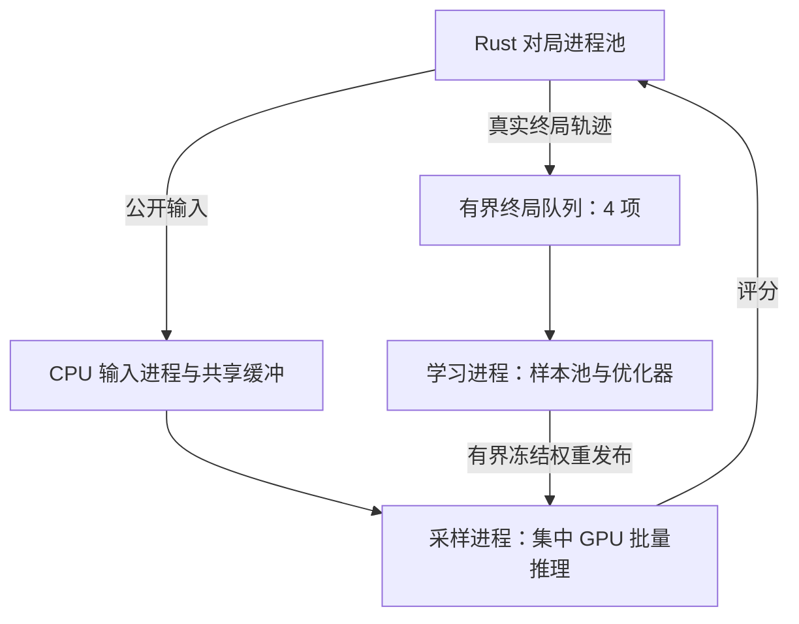

# 采样与学习执行架构

[性能入口](../PERFORMANCE.md) · [测量结果](MEASUREMENTS.md) · [诊断方法](DIAGNOSTICS.md)

正式模型仍为 `entity-transformer-v3`，11,695,874 个参数；公开编码、候选域、MC-Q v2、终局收益、补偿 BF16 AdamW 和每局 20,000 命令 / 1,000 ply 预算保持原定义。CUDA 默认采用独立采样进程，CPU 参考执行和固定权重评测复用本地 Pool。

- 采样进程拥有冻结推理模型、历史快照和环境池；学习进程拥有可变模型、优化器、RAM 样本池、保存与评测。学习和保存期间采样继续。
- 终局队列四项。队列满时，结案槽保留自身轨迹，交接后独立补局；其他在途局继续推理。每槽最多一条在途或待交接轨迹，暂存条数受最多 128 槽约束。每局仍最多保留 128 条样本，单样本上限 512 KiB。
- 逐请求传共享缓冲描述符与 BF16 评分；只有真实结案将轨迹交给学习器，沿用同一 `MemoryJobs.finish` 物化样本及收益。截断和取消保持 unknown。暂停排空已完成轨迹，再取消在途局；恢复点仍只保存学习状态，RAM 样本与在途局不落盘。
- 权重邮箱最多一项，另合并保留最新待发版本。当前策略最多四份根快照，同根绑定原版本，新根领取最新发布版本；历史对手整局冻结。无引用版本回收，下一局已选历史计划也持有租约。
- 一次 CPU 权重快照同时供摘要、发布与历史保存使用。采样池清理使用弱引用，避免回调额外保留旧模型。
- Notebook 默认 `HOST_WORKERS=-1`，按 CPU/RAM 自动选择输入进程；显式数量仍可覆盖。多进程不改变训练 batch 或自动更新公式。
